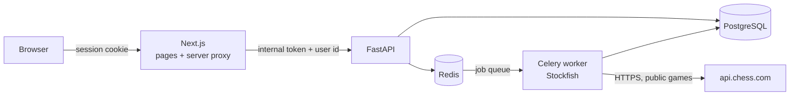

<div align="center">


# Caissa

**Free, open-source game review for Chess.com players.**
Sign in, enter a public Chess.com username, and see where your games go wrong: a blunder heatmap across your whole library, a weakness report, and puzzles built from your own mistakes.

[](https://github.com/UdayRajSahai2/caissa/actions/workflows/frontend.yml)
[](https://github.com/UdayRajSahai2/caissa/actions/workflows/dependency-audit.yml)


</div>

---

## Contents

- [Features](#features)
- [How it works](#how-it-works)
- [Tech stack](#tech-stack)
- [Getting started](#getting-started)
- [Testing and quality](#testing-and-quality)
- [Project structure](#project-structure)
- [Security and privacy](#security-and-privacy)
- [Accessibility](#accessibility)
- [Contributing](#contributing)
- [License and credits](#license-and-credits)

## Features

| | |
| --- | --- |
| **Blunder heatmap** | Every blunder in your library plotted on one board, so you can see which squares and pieces cost you the most games. |
| **Weakness report** | Your worst game phase, the pieces you blunder with most, and the patterns that keep repeating. |
| **Full game review** | Move-by-move review with accuracy, an evaluation graph, key moments, move labels (best, inaccuracy, mistake, blunder) and a time graph. |
| **Personal puzzles** | Puzzles taken from your own blunders, with step-by-step hints (which piece, then where it goes) and a full solution. |
| **Spaced repetition** | A missed puzzle comes back tomorrow; one you solve on two separate days counts as learned. |
| **Progress and streaks** | Daily goal, streak with a weekly rest day, XP, chess ranks from Pawn to King, badges, and mastery by game phase. |
| **Lessons** | Short interactive lessons on forks, pins and other tactics, open to everyone without signing in. |
| **Installable app** | Works as a PWA with a fast first load and recent reports available offline. |

Caissa never asks for your Chess.com password. It reads only public games through the official Chess.com API.

## How it works



1. You sign in with GitHub or Google (Auth.js) and enter a Chess.com username.
2. The browser never talks to the API directly. Next.js forwards each request through an allowlisted server proxy, adding a shared internal token and your user id.
3. FastAPI queues jobs. A Celery worker downloads new public games and scores each move with Stockfish. Stockfish never runs inside a web request.
4. Results are stored in PostgreSQL, keyed by Chess.com username, so a library analyzed once is ready for anyone who looks it up later.
5. The page checks for progress and fills in the heatmap, report and puzzles as games finish scoring.

## Tech stack

| Layer | Tools |
| --- | --- |
| Frontend | Next.js 15 (App Router), React 19, TypeScript (strict), CSS Modules with design tokens, Auth.js (next-auth) |
| Backend | Python 3.11+, FastAPI, Pydantic v2, SQLAlchemy 2, Alembic |
| Jobs | Celery with Redis, Stockfish via python-chess |
| Data | PostgreSQL 16, Redis 7 |
| Testing | Vitest, React Testing Library, Playwright with axe, pytest |

## Getting started

### Prerequisites

- [Node.js](https://nodejs.org/) 22
- [Python](https://www.python.org/) 3.11 or newer
- [Docker](https://www.docker.com/) (runs PostgreSQL and Redis)
- [Stockfish](https://stockfishchess.org/download/) installed locally
- A GitHub and/or Google OAuth app for sign-in

### 1. Clone and configure

```bash
git clone https://github.com/UdayRajSahai2/caissa.git
cd caissa
cp .env.example .env
cp frontend/.env.example frontend/.env.local
```

Fill in the blanks:

| File | Setting | Value |
| --- | --- | --- |
| `.env` | `STOCKFISH_PATH` | Full path to your Stockfish binary |
| `.env` | `INTERNAL_TOKEN` | A long random string |
| `frontend/.env.local` | `CAISSA_INTERNAL_TOKEN` | The same string as `INTERNAL_TOKEN` |
| `frontend/.env.local` | `NEXTAUTH_SECRET` | Another long random string, e.g. `openssl rand -base64 32` |
| `frontend/.env.local` | `GITHUB_ID` / `GITHUB_SECRET` | From a [GitHub OAuth app](https://github.com/settings/developers) with callback `http://localhost:3000/api/auth/callback/github` |
| `frontend/.env.local` | `GOOGLE_ID` / `GOOGLE_SECRET` | From a [Google OAuth client](https://console.cloud.google.com/apis/credentials) with callback `http://localhost:3000/api/auth/callback/google` |

Leave a provider's id empty to hide its sign-in button. Both env files are gitignored; never commit them.

### 2. Install dependencies

```bash
# Backend
cd backend
python -m venv .venv
source .venv/bin/activate        # Windows: .\.venv\Scripts\Activate.ps1
pip install -e ".[dev]"
cd ..

# Frontend
cd frontend
npm ci
cd ..
```

### 3. Run

**Windows, one command:** starts Postgres, Redis, migrations, the API, the worker and the site.

```powershell
powershell -ExecutionPolicy Bypass -File .\dev.ps1
```

**Any OS, by hand:** use one terminal per process.

```bash
docker compose up -d --wait

cd backend
alembic upgrade head
uvicorn app.main:create_app --factory --reload --port 8000
celery -A app.worker.celery_app worker -Q ingestion,analysis --loglevel=info
# On Windows add --pool=solo to the celery command.

cd frontend
npm run dev
```

Open http://localhost:3000. The API docs are at http://127.0.0.1:8000/docs while `ENABLE_DOCS=true`.

## Testing and quality

```bash
# Frontend (from frontend/)
npm run lint
npx tsc --noEmit
npm run test        # unit and component tests (Vitest)
npm run test:a11y   # Playwright + axe accessibility smoke tests
npm run build

# Backend (from backend/, venv active)
pytest
mypy app
pip-audit
```

CI runs the frontend checks and a dependency audit on every push.

## Project structure

```text
caissa/
├── frontend/              Next.js app
│   ├── src/app/           routes, layouts, server proxy (/api/caissa)
│   ├── src/components/    UI components with co-located CSS and tests
│   ├── src/lib/           pure helpers: heatmap maths, game review, progress
│   ├── src/messages/      all user-facing copy
│   ├── src/styles/        design tokens
│   └── e2e/               Playwright tests
├── backend/
│   ├── app/api/           routes, schemas, auth, rate limits
│   ├── app/adapters/      Chess.com HTTP client
│   ├── app/domain/        pure chess logic: blunders, positions, progress
│   ├── app/engine/        Stockfish wrapper
│   ├── app/worker/        Celery app and tasks
│   ├── app/db/            models and repositories
│   ├── alembic/           database migrations
│   └── tests/
├── docs/                  engineering guides (architecture, QA, security, craft)
├── game-insights-spec.md  product specification with requirement IDs
├── SECURITY.md            security controls
└── compose.yml            local PostgreSQL and Redis
```

Every feature traces back to a requirement ID in [`game-insights-spec.md`](game-insights-spec.md).

## Security and privacy

- Sign-in through GitHub or Google only; Caissa never sees a Chess.com password.
- A strict, per-request nonce Content Security Policy and standard security headers.
- The API accepts calls only from the Next.js proxy, which checks an allowlist, the request origin and an invisible proof-of-work bot check.
- Per-user and global rate limits backed by Redis.
- Chess.com requests go only to `api.chess.com` over HTTPS, with redirects refused.
- Every input is validated at the boundary, and errors never echo raw input or leak stack traces.

See [`SECURITY.md`](SECURITY.md) for the full list of controls.

## Accessibility

Caissa aims to be aligned with WCAG 2.2 Level AA: semantic HTML, full keyboard play on every board, visible focus, screen-reader announcements for moves and results, reduced-motion support, and colour contrast checked in light and dark themes. Automated axe checks run in the Playwright suite. No formal audit has been completed, so this is a goal, not a certification.

## Contributing

Issues and pull requests are welcome.

1. Read [`AGENTS.md`](AGENTS.md) and the guides in [`docs/`](docs/README.md). They apply to human contributors too.
2. Link your change to a requirement ID in the spec, or propose a spec change first.
3. Make sure lint, type checks and tests pass for the parts you touched.
4. Keep changes small and focused.

## License and credits

No open-source licence has been chosen for the code yet, so for now all rights are reserved by the author.

- Chess pieces: **Staunty** set by sadsnake1, from [Lichess](https://github.com/lichess-org/lila/tree/master/public/piece/staunty), licensed [CC BY-NC-SA 4.0](https://creativecommons.org/licenses/by-nc-sa/4.0/). See [`frontend/public/pieces/staunty/LICENSE.txt`](frontend/public/pieces/staunty/LICENSE.txt).
- Engine: [Stockfish](https://stockfishchess.org/) (GPLv3), run as a separate program.
- Game data: the public [Chess.com API](https://www.chess.com/news/view/published-data-api). Caissa is not affiliated with or endorsed by Chess.com.
